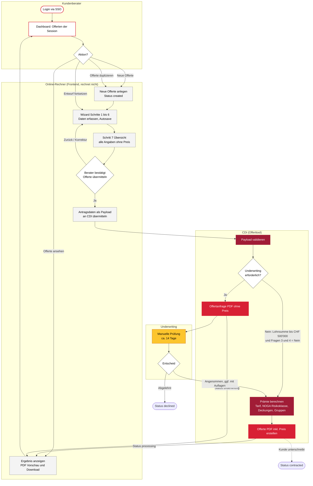
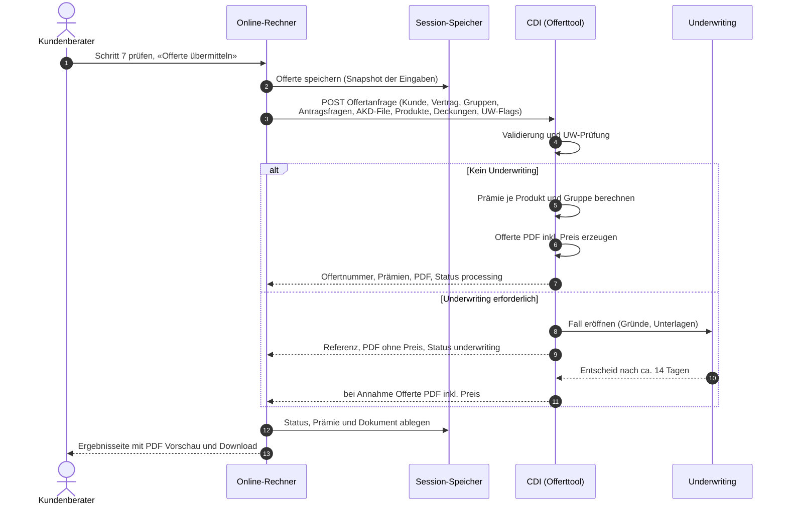
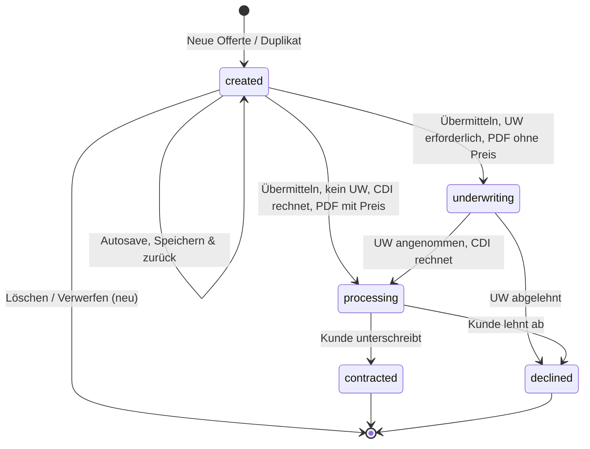
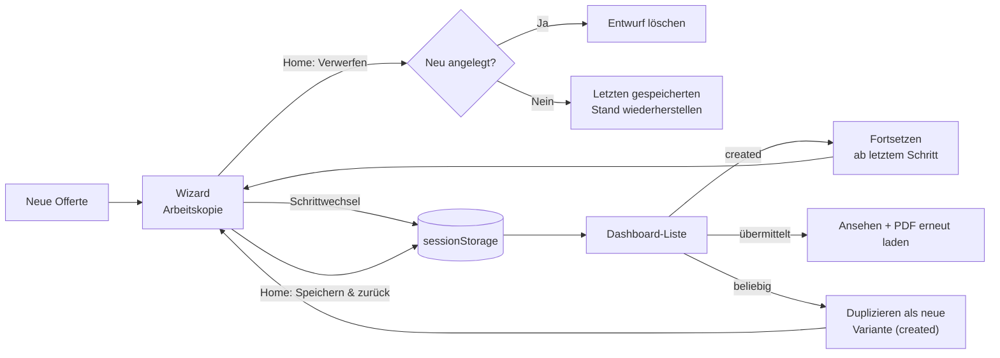
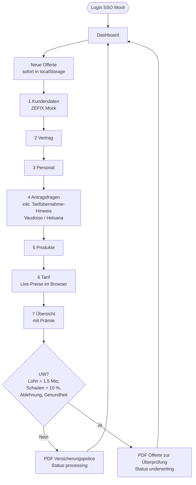

# 02 · Prozess-Flowcharts

Dieses Dokument enthält die komplette Prozesslogik als Mermaid-Diagramme (rendert direkt auf GitHub).

1. Soll-Prozess Gesamtübersicht (Berater, Online-Rechner, CDI, Underwriting)
2. Soll-Prozess Detail-Logik im Wizard (alle Entscheidungen und Validierungen)
3. Sequenz der Übermittlung an das CDI
4. Statusmodell einer Offerte
5. Session-Speicherung und Wiederverwendung
6. Ist-Prozess (Original) zum Vergleich

## Änderungen Soll gegenüber Ist

| Thema | Ist (Figma-Prototyp) | Soll (elipsLife/Swiss Life Umgebung) |
|---|---|---|
| Prämienberechnung | Im Browser (Dummy-Formeln) | **Im CDI** (Offerttool). Der Online-Rechner rechnet nie |
| Preise im Schritt «Tarif» | Live-Preise und Preisdifferenzen | **Keine Preise**. Nur Deckungskonfiguration |
| Preise in der Übersicht | Prämienübersicht | **Keine Preise**. Vollständige Zusammenfassung, dann «Offerte übermitteln» |
| Preis sichtbar | Sofort | **Erst im PDF der Offerte**, das nach der CDI-Berechnung erstellt wird |
| Automatische Tarifübernahme (Vaudoise/Helsana) | Hinweistext in Antragsfrage 1 | **Entfällt** |
| Underwriting Lohnsumme | > CHF 1'500'000 | **> CHF 500'000** (bis und mit CHF 500'000 direkte Offerte) |
| Underwriting Schaden > 10 % | Ja | **Entfällt**. Schadenangaben und AKD-File werden weiterhin erfasst und übermittelt |
| Underwriting Ablehnung / Gesundheit | Ja | **Bleibt** |
| Endprodukt | «Versicherungspolice» PDF | **Offerte** PDF inkl. Preis (bzw. Offertanfrage ohne Preis bei Underwriting) |
| ZEFIX | Mock | **Echte ZEFIX-Suche** (Name oder UID) mit Adressübernahme |
| FAQ-Chatbot | Keyword-Bot | **Kontaktformular per E-Mail** mit automatisch angehängtem Offert-Kontext |
| Speicherung | localStorage (dauerhaft) | **sessionStorage** (laufende Session): fortsetzen, ansehen, duplizieren |

## 1. Soll-Prozess Gesamtübersicht

**Wichtig:** Die Underwriting-Prüfung wird im Online-Rechner bereits **angezeigt** (Hinweis für den Berater), die verbindliche Entscheidung trifft aber das CDI. So liegen die Regeln an einer Stelle. Im Prototyp spielt ein CDI-Mock diese Rolle.

## 2. Soll-Prozess Detail-Logik im Wizard

```mermaid
flowchart TD
    classDef step fill:#FFFFFF,stroke:#D82034,stroke-width:2px,color:#000
    classDef rule fill:#F4F4F4,stroke:#808080,color:#000
    classDef warn fill:#FFF4D6,stroke:#C45417,color:#000
    classDef cdi fill:#A11C36,stroke:#A11C36,color:#FFF

    S0(["Start: Neue Offerte oder Entwurf"]) --> S1

    subgraph ST1["Schritt 1 · Kundendaten"]
        S1["Formular Kundendaten"]:::step
        Z1{"ZEFIX-Suche<br/>nach Name oder UID?"}:::rule
        Z2["Treffer wählen<br/>Name, UID, Adresse, PLZ, Ort übernehmen"]:::rule
        S1a["Branche wählen<br/>NOGA-Liste wird gefiltert"]:::rule
        S1b["NOGA-Code wählen<br/>Risikoklasse A bis E anzeigen"]:::rule
        S1c["Kundenberater zuweisen<br/>optional mehrere mit Split"]:::rule
        V1{"Pflichtfelder ok,<br/>Branche und NOGA gesetzt,<br/>Split = 100 %?"}:::rule
    end
    S1 --> Z1
    Z1 -- "Ja" --> Z2 --> S1a
    Z1 -- "Nein, manuell" --> S1a
    S1a --> S1b --> S1c --> V1
    V1 -- "Nein" --> S1
    V1 -- "Ja" --> S2

    subgraph ST2["Schritt 2 · Vertrag"]
        S2["Vertragsstart, Zahlungsfrequenz,<br/>Vertragsdauer"]:::step
        V2{"Alles gesetzt?"}:::rule
    end
    S2 --> V2
    V2 -- "Nein" --> S2
    V2 -- "Ja" --> S3

    subgraph ST3["Schritt 3 · Personal"]
        S3["Personengruppen erfassen<br/>Anzahl und Lohnsumme je Geschlecht"]:::step
        S3a{"Namentlich<br/>versicherte Person?"}:::rule
        S3b["Typ, Geschlecht, Name,<br/>Lohnsumme für 1 Person"]:::rule
        S3c["Aufteilung obligatorisch / Überschuss<br/>Grenze CHF 148'200 pro Person,<br/>Überschuss manuell anpassbar"]:::rule
        S3d{"Gesamtlohnsumme<br/>> CHF 500'000?"}:::rule
        S3e["Hinweis: Underwriting erforderlich,<br/>Offerte ohne Preis"]:::warn
        V3{"Jede Gruppe mit Name,<br/>mind. 1 Person und Lohn > 0?"}:::rule
    end
    S3 --> S3a
    S3a -- "Ja" --> S3b --> S3c
    S3a -- "Nein" --> S3c
    S3c --> S3d
    S3d -- "Ja" --> S3e --> V3
    S3d -- "Nein" --> V3
    V3 -- "Nein" --> S3
    V3 -- "Ja" --> S4

    subgraph ST4["Schritt 4 · Antragsfragen"]
        S4["Frage 1: Bestehende Versicherungen<br/>bei Ja Gesellschaft und Policennummer"]:::step
        S4b["Frage 2: Schäden letzte 5 Jahre<br/>bei Ja Betrag und AKD-File Upload"]:::step
        S4c{"Frage 3: Ablehnung<br/>letzte 5 Jahre?"}:::rule
        S4d{"Frage 4: Gesundheit<br/>a, b, c oder d = Ja?"}:::rule
        S4e["Hinweis: Underwriting erforderlich<br/>Details erfassen"]:::warn
        V4{"Alle Fragen beantwortet?"}:::rule
    end
    S4 --> S4b --> S4c
    S4c -- "Ja" --> S4e
    S4c -- "Nein" --> S4d
    S4e --> S4d
    S4d -- "Ja" --> S4f["Hinweis: Underwriting erforderlich<br/>Details erfassen"]:::warn --> V4
    S4d -- "Nein" --> V4
    V4 -- "Nein" --> S4
    V4 -- "Ja" --> S5
    NoteTU["Entfällt: Automatische Tarifübernahme<br/>Entfällt: UW bei Schaden > 10 %"]:::warn -.- S4b

    subgraph ST5["Schritt 5 · Produkte"]
        S5{"SUVA-unterstellt?"}:::step
        S5a["Unfall = nur UVGZ<br/>UVG bleibt bei SUVA, gesperrt"]:::rule
        S5b["Unfall = UVG + UVGZ"]:::rule
        S5c["Krankheit = KTG"]:::rule
        V5{"Mind. 1 Produkt gewählt?"}:::rule
    end
    S5 -- "Ja" --> S5a --> S5c
    S5 -- "Nein" --> S5b --> S5c
    S5c --> V5
    V5 -- "Nein" --> S5
    V5 -- "Ja" --> S6

    subgraph ST6["Schritt 6 · Tarif (ohne Preise)"]
        S6{"Überschusslohn vorhanden?"}:::step
        S6a["Empfehlung: UVGZ Privat weltweit,<br/>IK 3fach Überschuss 350 %, TK 2fach,<br/>Taggeld 90 % / 30 T; KTG 90 % / 30 T<br/>mit Lohnnachgenuss"]:::rule
        S6b["Empfehlung: UVGZ optional,<br/>KTG 80 % / 60 T ohne Lohnnachgenuss"]:::rule
        S6c{"Empfehlung übernehmen<br/>oder individuell?"}:::rule
        S6d["Deckungen konfigurieren,<br/>optional pro Personengruppe"]:::rule
    end
    S6 -- "Ja" --> S6a --> S6c
    S6 -- "Nein" --> S6b --> S6c
    S6c -- "Individuell" --> S6d --> S7
    S6c -- "Übernehmen" --> S7

    subgraph ST7["Schritt 7 · Übersicht"]
        S7["Zusammenfassung aller Angaben<br/>keine Preise"]:::step
        S7a{"Underwriting-Flags?<br/>Lohnsumme > 500'000,<br/>Frage 3 oder 4 = Ja"}:::rule
        S7b["Button: Offerte übermitteln"]:::step
        S7c["Button: Zur Prüfung übermitteln<br/>mit UW-Begründung"]:::warn
    end
    S7 --> S7a
    S7a -- "Nein" --> S7b
    S7a -- "Ja" --> S7c
    S7b --> CDI1["CDI: Prämie berechnen"]:::cdi --> PDF1["Offerte PDF inkl. Preis<br/>Status processing"]:::cdi
    S7c --> CDI2["CDI: UW-Fall registrieren"]:::cdi --> PDF2["Offertanfrage PDF ohne Preis<br/>Status underwriting"]:::cdi
    PDF1 --> E(["Ergebnisseite: PDF ansehen, herunterladen,<br/>zurück zum Dashboard"])
    PDF2 --> E
```

Navigation in allen Schritten: Mit «Zurück» und über den Stepper lassen sich bereits erreichte Schritte jederzeit öffnen. Bei jedem Schrittwechsel wird automatisch gespeichert.

## 3. Sequenz: Übermittlung an das CDI

## 4. Statusmodell

Die Statuswerte des Originals bleiben bestehen.

| Status | Bedeutung im Soll | Bearbeitbar | Dokumente |
|---|---|---|---|
| `created` | Entwurf | ja | keine |
| `processing` | An CDI übermittelt, Offerte mit Preis erstellt, wartet auf Kundenentscheid | nein (duplizieren möglich) | Offerte, Antragsformular |
| `underwriting` | Manuelle Prüfung | nein | Offertanfrage, Antragsformular |
| `contracted` | Abgeschlossen | nein | Offerte, Police, Rechnungen |
| `declined` | Abgelehnt | nein | Antragsformular |

Im Prototyp lassen sich die Übergänge nach `processing`, `contracted` und `declined` in der Detailansicht über «Demo-Aktionen» auslösen, damit der ganze Lebenszyklus vorführbar ist.

## 5. Session-Speicherung und Wiederverwendung

Die Daten liegen nur in der laufenden Browser-Session. Schliesst der Benutzer den Tab, sind sie weg. Das ist bewusst so gewählt (keine Persistenz ohne Backend).

## 6. Ist-Prozess (Original) zum Vergleich

