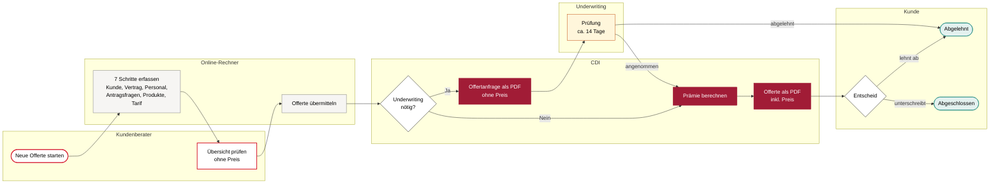
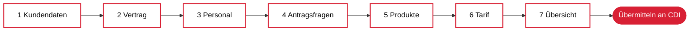
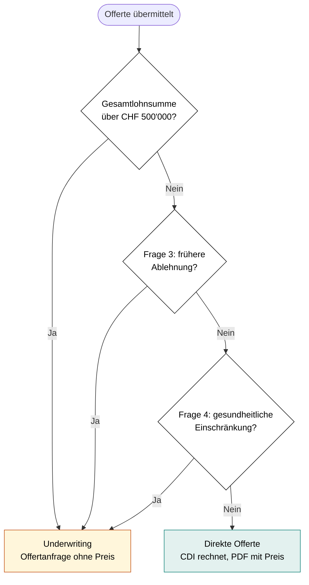
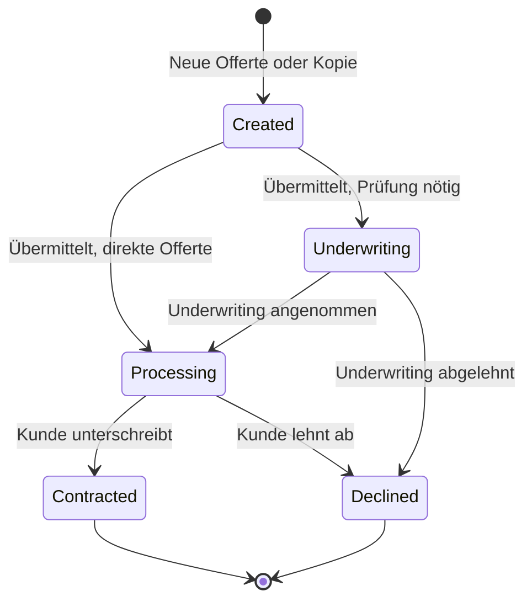

# Offertprozess Personenversicherung

**Kollektivversicherung für Firmenkunden: UVG, UVGZ und KTG**

Der Kundenberater erfasst eine Offerte in sieben Schritten im Online-Rechner. Die Prämie berechnet ausschliesslich das **CDI** (Offerttool). Der Preis ist erst in der **Offerte als PDF** sichtbar, die nach der Übermittlung entsteht.

> Eine gestaltete Fassung dieses Prozesses liegt unter [`docs/prozess.html`](prozess.html) (im Browser öffnen).

## Auf einen Blick

| | |
|---|---|
| **Wer erfasst** | Kundenberater von Swiss Life |
| **Wo** | Online-Rechner, 7 Schritte |
| **Wer rechnet** | CDI, nach der Übermittlung |
| **Wann ist der Preis sichtbar** | Erst in der Offerte (PDF). Nicht im Schritt «Tarif» und nicht in der «Übersicht» |
| **Direkte Offerte** | Gesamtlohnsumme bis und mit CHF 500'000, keine frühere Ablehnung, keine gesundheitlichen Einschränkungen |
| **Underwriting** | Lohnsumme über CHF 500'000, frühere Ablehnung oder gesundheitliche Einschränkung. Bearbeitung ca. 14 Tage |
| **Produkte** | UVG (obligatorische Unfallversicherung), UVGZ (Unfall-Zusatzversicherung), KTG (Krankentaggeld) |

## Beteiligte

| Rolle | Aufgabe im Prozess |
|---|---|
| **Kundenberater** | Erfasst Kunde, Personal, Antragsfragen und Deckungen. Prüft die Übersicht und übermittelt. |
| **Online-Rechner** | Führt durch die Erfassung, prüft Pflichtangaben, zeigt Hinweise zum Underwriting. Rechnet keine Prämien. |
| **CDI (Offerttool)** | Entscheidet verbindlich über das Underwriting, berechnet die Prämie und erstellt die Offerte als PDF. |
| **Underwriting** | Prüft Anfragen, die nicht direkt offeriert werden können. |
| **Kunde** | Erhält die Offerte und unterschreibt oder lehnt ab. |

## 1. Gesamtablauf

## 2. Die sieben Schritte

Mit «Weiter» geht es nur, wenn alle Pflichtangaben des Schritts vollständig sind. Bereits erreichte Schritte lassen sich jederzeit über die Schrittleiste wieder öffnen. Bei jedem Schrittwechsel wird automatisch gespeichert.

### Schritt 1 · Kundendaten

* **Firma aus ZEFIX übernehmen:** Suche im Handelsregister nach Firmenname oder UID. Firmenname, UID und Adresse werden übernommen.
* **Unternehmen:** Firmenname, UID-Nummer (Format CHE-123.456.789), Branche, NOGA-Code. Die Branche filtert die NOGA-Liste. Der NOGA-Code bestimmt die Risikoklasse A bis E.
* **Kontakt und Adresse:** Kontaktperson, E-Mail, Telefon, Strasse, PLZ, Ort.
* **Kundenberater:** Ein oder mehrere Berater. Bei mehreren Beratern wird die Abschlussprovision aufgeteilt, die Summe muss 100 % ergeben. Neue Berater lassen sich direkt erfassen.

### Schritt 2 · Vertrag

* Vertragsstart (Vorschlag: 1. des nächsten Monats)
* Zahlungsfrequenz: jährlich oder halbjährlich
* Vertragsdauer: 1, 3 oder 5 Jahre

### Schritt 3 · Personal

* Eine oder mehrere **Personengruppen**, z.B. «Das gesamte Personal» oder «Kader». Jede Person gehört genau einer Gruppe an.
* Pro Gruppe Anzahl und jährliche AHV-Lohnsumme, getrennt nach Männern und Frauen.
* **Namentlich versicherte Person:** Betriebsinhaber oder mitarbeitende Familienmitglieder mit fester Jahreslohnsumme (AHV-Lohn plus Gewinnungskosten, diese max. 30 % des AHV-Lohns und max. CHF 50'000).
* **Lohnaufteilung:** Der Lohn wird in den **obligatorischen Lohn** (bis CHF 148'200 pro Person, UVG-Maximum) und den **Überschusslohn** aufgeteilt. Der Überschusslohn kann angepasst werden.
* Liegt die Gesamtlohnsumme über CHF 500'000, erscheint sofort der Hinweis «Underwriting erforderlich».

### Schritt 4 · Antragsfragen

| Frage | Inhalt | Folge |
|---|---|---|
| 1. Bestehende Versicherungen | KTG nach VVG, UVG, UVGZ nach VVG. Bei Ja: Versicherungsgesellschaft und Policennummer | Nur Information |
| 2. Schäden der letzten 5 Jahre | Bei Ja: Gesamtschadenbetrag und **AKD-File** des Vorversicherers hochladen | **Kein** Underwriting |
| 3. Versicherungsannahme | Wurde eine Kollektivversicherung in den letzten 5 Jahren abgelehnt oder erschwert? | Bei Ja: **Underwriting** |
| 4. Gesundheitszustand | Chronisch krank, aktuell arbeitsunfähig, längere Arbeitsunfähigkeit erwartet, invalid? | Bei einem Ja: **Underwriting** |

### Schritt 5 · Produkte

* Zuerst die Frage: **Ist die Firma der SUVA unterstellt?**
* **Unfall:** ohne SUVA UVG und UVGZ, mit SUVA nur UVGZ (die UVG bleibt bei der SUVA).
* **Krankheit:** KTG.
* Mindestens ein Bereich muss gewählt sein.

### Schritt 6 · Tarif

Hier werden nur die **Deckungen** festgelegt. Es werden **keine Preise** angezeigt.

| | Mit Überschusslohn | Ohne Überschusslohn |
|---|---|---|
| **UVGZ** | Empfohlen: Heilungskosten Privatabteilung weltweit, Invaliditätskapital 3-fach Überschusslohn mit 350 % Progression, Todesfallkapital 2-fach Überschusslohn, Taggeld 90 % ab 30 Tagen | Optional, meist nicht nötig |
| **KTG** | 90 %, Wartefrist 30 Tage, mit Lohnnachgenuss | 80 %, Wartefrist 60 Tage, ohne Lohnnachgenuss |

* «Empfehlung übernehmen» oder «Individuell anpassen».
* Individuell: UVGZ (Heilungskosten, Invaliditätskapital mit Basis, Multiplikator und Progression, Todesfallkapital, Taggeld) und KTG (Leistungshöhe 80 / 90 / 100 %, Wartefrist 30 / 60 / 90 Tage, Lohnnachgenuss).
* Bei mehreren Personengruppen können Produkte und Deckungen **pro Gruppe** unterschiedlich sein.
* Bei SUVA-unterstellten Firmen kann UVG nicht gewählt werden.

### Schritt 7 · Übersicht

* Alle Angaben auf einen Blick, **ohne Preis**. Jeder Bereich lässt sich direkt bearbeiten.
* Der Rechner zeigt, ob eine direkte Offerte möglich ist oder ob Underwriting nötig wird, inklusive Begründung.
* Button **«Offerte übermitteln»** bzw. **«Zur Prüfung übermitteln»**.

## 3. Underwriting-Entscheid

* Vorschäden (Frage 2) lösen **kein** Underwriting aus. Betrag und AKD-File gehen trotzdem mit der Anfrage ans CDI.
* Der Rechner zeigt die Hinweise schon während der Erfassung. **Verbindlich entscheidet das CDI.**

## 4. Übermittlung und Ergebnis

| | Direkte Offerte | Underwriting |
|---|---|---|
| **Im CDI** | Prämie wird je Produkt und Personengruppe berechnet | Fall wird dem Underwriting zugewiesen |
| **Dokument** | **Offerte** als PDF mit Prämie je Produkt, Jahresprämie total, Deckungsübersicht, Antragsfragen und Unterschriftsfeldern | **Offertanfrage** als PDF ohne Preis, mit den Gründen für das Underwriting |
| **Status** | Processing | Underwriting |
| **Danach** | Kunde unterschreibt oder lehnt ab | Nach ca. 14 Tagen: angenommen (CDI rechnet, Offerte mit Preis folgt) oder abgelehnt |

## 5. Status einer Offerte

| Status | Bedeutung | Bearbeitbar | Dokumente |
|---|---|---|---|
| **Created** | Entwurf, noch nicht übermittelt | Ja | Antragsformular (aktueller Stand) |
| **Processing** | Offerte erstellt, wartet auf den Kunden | Nein, duplizieren möglich | Offerte, Antragsformular |
| **Underwriting** | In Prüfung | Nein, duplizieren möglich | Offertanfrage, Antragsformular |
| **Contracted** | Abgeschlossen | Nein, duplizieren möglich | Offerte, Police, Rechnungen |
| **Declined** | Abgelehnt | Nein, duplizieren möglich | Antragsformular |

## 6. Mit Offerten arbeiten

| Aktion | Wann | Was passiert |
|---|---|---|
| **Fortsetzen** | Status Created | Öffnet den Entwurf beim zuletzt bearbeiteten Schritt |
| **Speichern & zurück** | Im Wizard über «Home» | Entwurf bleibt erhalten |
| **Verwerfen** | Im Wizard über «Home» | Neue Offerte wird gelöscht, bestehender Entwurf auf den letzten Stand zurückgesetzt |
| **Ansehen** | Jeder Status | Detailansicht mit allen Angaben und Dokumenten, PDF erneut herunterladen |
| **Duplizieren** | Jeder Status | Neue Offerte mit allen Angaben als Vorlage, z.B. für eine Variante mit anderer Wartefrist |
| **Löschen** | Status Created | Entwurf wird entfernt |
| **Kontakt** | Überall über «Fragen?» | E-Mail mit automatisch angehängtem Kontext (Schritt, Firma, Offerte) |

Gespeichert wird während der laufenden Sitzung im Browser.

## 7. Dashboard

* **Kennzahlen:** Offerten total, Contracted, Underwriting, Win Rate (letzte 90 Tage), Prämien- und Lohnvolumen der abgeschlossenen Offerten.
* **Diagramme:** Statusverteilung, Offerten pro Monat, Abschlussrate über 12 Monate.
* **Offertübersicht:** Suche, Filter nach Status, Erstellungsdatum, Lohnsumme und Mitarbeitenden, Sortierung.
* **Ihre Offerten in dieser Sitzung:** Schnellzugriff zum Fortsetzen, Ansehen und Duplizieren.

## 8. Zu bestätigen

| Punkt | Aktuelle Annahme |
|---|---|
| Gültigkeit der Offerte | 30 Tage ab Berechnung |
| Grenze Underwriting | Bis und mit CHF 500'000 direkte Offerte |
| Zahlungsfrequenzen | Jährlich und halbjährlich |
| Tarif und Risikoklassen | Kommen aus dem CDI |
